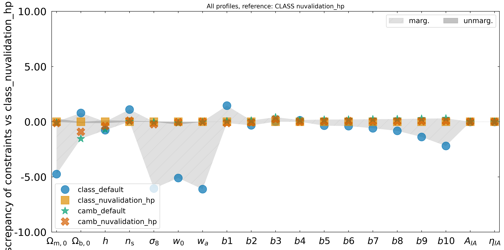

# Default vs high-precision Boltzmann profiles

## Summary

CosmicFishPie ships two kinds of Boltzmann-solver settings for the `class` and `camb`
backends: relaxed `default.yaml` profiles, used automatically when no
`class_config_yaml` / `camb_config_yaml` is given, and the paper-validated
`nuvalidation_hp.yaml` profiles (Archidiacono et al., arXiv:2405.06047v1). This page
records a rough check of how much the cheap default profiles change a photometric Fisher
forecast, compared with the high-precision ones.

Findings:

- **CAMB:** `default.yaml` reproduces `nuvalidation_hp.yaml` to better than 1% on every
  marginalised 1-sigma error (below 0.04% unmarginalised), at about **4.6x lower Fisher
  cost** (30 s vs 138 s).
- **CLASS:** `default.yaml` differs from `nuvalidation_hp.yaml` by up to about 6% on the
  marginalised cosmological errors (below 0.3% unmarginalised), at about **1.7x lower
  cost** (111 s vs 186 s).
- **Cross-code:** with the `nuvalidation_hp` profiles, CLASS and CAMB agree to below 1%
  on all marginalised errors. With the `default` profiles they differ by up to about
  6.5%, and that gap comes almost entirely from the CLASS default.

Decision: the `default.yaml` profiles are accurate enough for exploratory work and for
the MCMC / likelihood runs where Fisher-level accuracy at the few-percent level is
acceptable, and they are used there. Use `nuvalidation_hp.yaml` when the forecast itself
is the result. CAMB defaults in particular give essentially the same constraints at a
fraction of the cost.

This is a rough check, not a validation. See [Caveats](#caveats).

## Setup

Four Fisher matrices were computed, one per code and profile:

| Case | Backend config |
|---|---|
| `class_default` | `class/default.yaml` |
| `class_nuvalidation_hp` | `class/nuvalidation_hp.yaml` |
| `camb_default` | `camb/default.yaml` |
| `camb_nuvalidation_hp` | `camb/nuvalidation_hp.yaml` |

The forecast setup is the same for all four, in the style of the case-02 photometric
campaign:

- Survey: `Euclid-Photometric-Paper-Pessimistic`, observables `GCph` + `WL`, with the
  photometric galaxy-clustering tracer set to matter (`P_mm`).
- Specs: `common_specs_paper_w0wa_fixed_mnu_Neff.json`, w0waCDM with `mnu` and `Neff`
  fixed.
- Free cosmological parameters: `Omegam`, `Omegab`, `h`, `ns`, `sigma8`, `w0`, `wa`.
- Nuisance parameters are also free, so they enter the marginalised errors: photometric
  bias `b1`-`b10` and intrinsic alignment `AIA`, `etaIA`.
- The backend YAML is passed explicitly through `<code>_config_yaml`.

For each case the script times one fiducial cosmology evaluation (a cold call plus warm
calls) and then one serial `FisherMatrix.compute()`. Parallel derivative evaluation was
not used, so timings are single-process wall times, not the best achievable. Each case
ran as its own 16-CPU job on JURECA with `OMP_NUM_THREADS=16`.

The driver script lives outside this repository, in the `cjfp-data` job repository, as
`jobs_punch/compare_backend_profiles.py` (subcommands `run`, `all`, `compare`). The
discrepancy plots come from `cosmicfishpie.analysis.plot_comparison.ploterrs`.

## What differs between the profiles

CLASS (`default.yaml` vs `nuvalidation_hp.yaml`):

| Setting | default | nuvalidation_hp |
|---|---|---|
| `k_per_decade_for_bao` | 70 | 50 |
| `k_per_decade_for_pk` | 10 | 50 |
| `non linear` | `hmcode_2020` | `hmcode2020` |
| `z_max_pk` | 5.0 | 4.0 |
| `nonlinear_min_k_max` | 150 | 80 |
| `use_ppf` | `yes` | not set |
| `tau_reio` | not set | 0.058 |
| neutrino and perturbation precision (`l_max_g`, `l_max_ncdm`, `tol_perturbations_integration`, `thermo_Nz_*`, `background_Nloga`, `hmcode_tol_sigma`, ...) | not set | tightened |

CAMB:

| Setting | default | nuvalidation_hp |
|---|---|---|
| `k_per_logint` | 20 | 50 |
| `AccuracyBoost` | 1 | 3 |
| `lAccuracyBoost` | 1 | 3 |
| `accurate_massive_neutrino_transfers` | `False` | `True` |
| `MassiveNuMethod` | 0 | not set |
| `tau` | not set | 0.058 |
| `WantTensors`, `WantVectors`, `Want_CMB_lensing`, `Want_cl_2D_array` | not set | `False` |

Note that `z_max_pk` is lower in the CLASS high-precision profile (4.0) than in the
default (5.0), and the `tau_reio` / `tau` handling differs. These are confounded with the
precision settings in this comparison; see [Caveats](#caveats).

## Timings

Wall times in seconds, from the saved `timing.json` of each case.

| Case | Cosmology evaluation | Fisher computation | Total job |
|---|---|---|---|
| `class_default` | 7.0 | 111.4 | 3 min 06 s |
| `class_nuvalidation_hp` | 11.9 | 186.4 | 4 min 46 s |
| `camb_default` | 1.5 | 29.8 | 1 min 18 s |
| `camb_nuvalidation_hp` | 8.5 | 137.7 | 3 min 40 s |

Cost of the high-precision profile relative to the default:

| Code | Cosmology evaluation | Fisher computation |
|---|---|---|
| CLASS | 1.7x | 1.7x |
| CAMB | 5.6x | 4.6x |

CAMB's default profile is the cheapest case overall: about four times faster than the
CLASS default for the Fisher, and about 4.6 times faster than its own high-precision
profile.

## Discrepancies in the 1-sigma constraints

All numbers are `100 * (a / b - 1)` of the 1-sigma errors derived from the Fisher
matrices.

### Default vs high-precision, same code

Reference `b` is the `nuvalidation_hp` profile of the same code.

| Parameter | CLASS marg. (%) | CAMB marg. (%) |
|---|---|---|
| `Omegam` | -4.75 | +0.03 |
| `Omegab` | +0.80 | -0.64 |
| `h` | -0.76 | -0.32 |
| `ns` | +1.11 | -0.07 |
| `sigma8` | -6.05 | +0.20 |
| `w0` | -5.10 | -0.08 |
| `wa` | -6.11 | -0.03 |
| `b1` | +1.46 | about +0.15 to +0.24 (`b1` to `b10`) |

- CLASS bias parameters stay within about +-2%.
- Unmarginalised errors agree to below 0.3% for CLASS (for example `Omegam` +0.28,
  `w0` -0.26, `h` +0.13) and below 0.04% for CAMB.

The CLASS differences are largest for `Omegam`, `sigma8`, `w0` and `wa`, and they mostly
disappear when the parameters are not marginalised. The cause was not investigated.

### CLASS vs CAMB

CAMB errors relative to CLASS errors (`a` is CAMB, `b` is CLASS), using the same profile
tier for both codes:

| Parameter | default profiles, CAMB vs CLASS marg. (%) | `nuvalidation_hp` profiles, CAMB vs CLASS marg. (%) |
|---|---|---|
| `Omegam` | +4.89 | -0.12 |
| `Omegab` | -2.32 | -0.91 |
| `h` | +0.05 | -0.39 |
| `ns` | -1.07 | +0.10 |
| `sigma8` | +6.41 | -0.23 |
| `w0` | +5.25 | -0.04 |
| `wa` | +6.48 | +0.01 |

- With the high-precision profiles CLASS and CAMB agree to below about 0.9% on all
  cosmological parameters.
- With the default profiles the same comparison gives up to about 6.5%. The mirror image
  of the CLASS default-vs-hp numbers above shows this is the CLASS default moving, not
  CAMB.
- Unmarginalised errors agree to below 0.3% in both comparisons.

## Plots

Discrepancy of the 1-sigma constraints of all four cases relative to the CLASS
`nuvalidation_hp` Fisher, made with `ploterrs`
(`compare_backend_profiles.py compare`).

## Recommendation

- **CAMB:** use `camb/default.yaml` for exploration and for MCMC chains. It matches the
  high-precision profile to well under 1% at a fifth of the Fisher cost.
- **CLASS:** `class/default.yaml` is acceptable for exploration and MCMC chains where a
  few-percent difference in the constraints is tolerable. Errors on `Omegam`, `sigma8`,
  `w0` and `wa` are up to about 6% different from the high-precision result. Use
  `class/nuvalidation_hp.yaml` when the CLASS Fisher is itself a result or is compared
  against CAMB.
- When quoting a CLASS-vs-CAMB agreement, state which profiles were used. Agreement at
  the percent level needs the high-precision profiles on both sides.

## Caveats

- **Nuisance parameters.** These Fishers marginalise over photometric bias (`b1`-`b10`)
  and intrinsic alignment (`AIA`, `etaIA`). They are therefore not identical to the
  fixed-nuisance convention of the case-02 campaign, and the marginalised percentages
  should not be compared one-to-one with those results.
- **Confounded CLASS settings.** `z_max_pk` is 4.0 in the CLASS high-precision profile
  but 5.0 in the default, and `tau_reio` and `use_ppf` also differ. The CLASS
  discrepancy is therefore not attributable to the precision parameters alone. A
  controlled test would change one group of settings at a time. This was not done.
- **Single fiducial, single configuration.** One fiducial cosmology, one survey and one
  derivative scheme. Percent-level Fisher agreement does not guarantee the same
  agreement for posteriors that probe far from the fiducial point.
- **Timings.** Serial Fisher, one run per case, on a shared cluster. Treat the ratios
  as indicative, not as benchmarks.
- **Not a validation.** The numbers describe how the default profiles compare with the
  high-precision profiles. They do not show that either is correct against an external
  reference. For that, see {doc}`backend_validation`.
